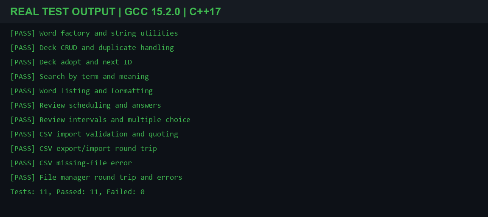

# BÁO CÁO CUỐI KỲ

## Flashcard Vocabulary Manager

**Môn học:** PRF193  
**Lớp học phần:** IC2113  
**Học kỳ:** Fall 2026  
**Giảng viên:** DatTT  
**Nhóm:** BetterMan  
**Công nghệ:** C++17, STL, CMake

### Thành viên và phân công

| Thành viên | Mã sinh viên | Phạm vi công việc |
|---|---|---|
| Đặng Đức Duy | HE210771 | Nhóm trưởng; phụ trách Word, Deck, ReviewScheduler, FileManager và Menu; tiếp nhận các phần việc còn lại ngoài phân công ban đầu để hoàn thiện sản phẩm. |
| Phạm Xuân Dũng | HE212513 | Phụ trách WordLister, CSV và Menu_List theo tài liệu thiết kế. |

### Tóm tắt

Flashcard Vocabulary Manager là ứng dụng console giúp người học quản lý và ôn tập từ vựng ngay trên máy tính. Người dùng có thể thêm, tìm kiếm, sửa, xóa, sắp xếp, nhập/xuất CSV và ôn các thẻ đến hạn bằng câu hỏi trắc nghiệm. Mỗi thẻ lưu từ hoặc cụm từ, từ loại, nghĩa và trạng thái ôn. Ứng dụng dùng C++17, tách dữ liệu, nghiệp vụ và giao diện thành các thành phần riêng, đồng thời lưu dữ liệu cục bộ để sử dụng lại giữa các lần chạy.

Lần kiểm thử được ghi nhận đạt 11/11 nhóm kiểm thử lõi; kiểm thử riêng cho WordLister cũng đạt. Báo cáo trình bày sản phẩm hiện tại và minh chứng thực tế, không thay thế hồ sơ nộp riêng của từng Lab.

<!-- PAGE BREAK -->

## 1. Bài toán, mục tiêu và phạm vi

Khi tự học từ mới, người học cần lưu thuật ngữ cùng nghĩa, tìm lại nhanh và biết khi nào cần ôn lại. Dự án hiện thực hóa quy trình này bằng một ứng dụng console chạy cục bộ, không yêu cầu tài khoản, máy chủ hay cơ sở dữ liệu từ xa.

### Mục tiêu

- Tổ chức từ đơn và cụm từ cùng các thông tin cần thiết cho việc học.
- Hỗ trợ tra cứu, quản lý bộ thẻ và lưu/nạp dữ liệu.
- Lên lịch ôn theo kết quả trả lời và cho phép thay đổi các khoảng ngày.
- Vận dụng hàm, cấu trúc dữ liệu, thuật toán và lập trình hướng đối tượng.

### Chức năng chính

| Chức năng | Mô tả |
|---|---|
| Quản lý thẻ | Thêm, sửa, xóa; Deck tự cấp ID và từ chối term trùng không phân biệt hoa/thường. |
| Tìm kiếm | Tìm chuỗi con trong từ/cụm từ hoặc nghĩa. |
| Liệt kê | Xem toàn bộ thẻ, sắp xếp theo alphabet hoặc số lần ôn. |
| Ôn tập | Lấy thẻ đến hạn, chọn nghĩa đúng; câu trả lời cập nhật lịch ôn. |
| Cấu hình lịch | Điều chỉnh năm mốc ngày theo thứ tự tăng dần. |
| CSV | Nhập và xuất dữ liệu để sao lưu hoặc chỉnh sửa bên ngoài ứng dụng. |
| Lưu/nạp | Tự động nạp bộ thẻ khi chạy và lưu khi thoát. |

Phạm vi hiện tại là ứng dụng console một người dùng, lưu dữ liệu dạng CSV trên máy. Tìm kiếm chưa đảm bảo chuẩn hóa hoa/thường Unicode cho mọi ký tự tiếng Việt có dấu.

<!-- PAGE BREAK -->

## 2. Thiết kế và triển khai

### Kiến trúc

| Lớp trách nhiệm | Thành phần tiêu biểu | Vai trò |
|---|---|---|
| Dữ liệu | `Word`, `VocabularyWord`, `PhraseWord`, `Deck` | Biểu diễn thẻ từ và quản lý bộ thẻ. |
| Nghiệp vụ và lưu trữ | `SearchService`, `WordLister`, `ReviewScheduler`, `CsvManager`, `FileManager` | Tìm kiếm, sắp xếp, lên lịch ôn và xử lý tệp. |
| Giao diện | `Menu` và các menu handler | Nhận lựa chọn, gọi nghiệp vụ và hiển thị kết quả. |

`main()` khởi tạo `Menu` và gọi `run()`. `Deck` lưu các thẻ bằng `vector<unique_ptr<Word>>`, thể hiện quyền sở hữu của Deck và cho phép quản lý từ đơn/cụm từ qua kiểu cơ sở chung. `Word::create` xác định loại thẻ theo nội dung term.

### Luồng hoạt động và dữ liệu

Khi khởi động, ứng dụng đọc lịch ôn và bộ thẻ từ thư mục `data`. Menu nhận yêu cầu, chuyển đến lớp nghiệp vụ tương ứng và cập nhật Deck. Khi thoát, ứng dụng ghi bộ thẻ; cấu hình lịch ôn được lưu riêng.

| Luồng dữ liệu | Thành phần và định dạng |
|---|---|
| Lưu trữ nội bộ | `FileManager` dùng `data/words.csv`, giữ ID, loại thẻ và trạng thái ôn để khôi phục. |
| Trao đổi | `CsvManager` dùng các cột term, từ loại, nghĩa, số lần ôn và ngày ôn; không xuất ID, ngày hiển thị theo `dd/MM/yyyy`. |
| Lịch ôn | `ReviewScheduler` dùng năm mốc mặc định `{1, 3, 7, 15, 30}` ngày; người dùng có thể thay đổi các giá trị. |

CMake cấu hình thư viện core, ứng dụng và executable kiểm thử; CTest chạy các test được đăng ký bằng `add_test`. Hướng dẫn build và test được duy trì trong README của dự án.

<!-- PAGE BREAK -->

## 3. Tư duy tính toán và nội dung môn học

Phần đối chiếu dưới đây mô tả minh chứng trong **sản phẩm hiện tại** theo bốn tiêu chí rubric; không khẳng định mã nguồn hiện tại trùng với phiên bản đã nộp ở từng Lab.

| Tiêu chí rubric | Trọng số | Minh chứng trong dự án |
|---|---:|---|
| Decomposition | 30% | Chia trách nhiệm giữa dữ liệu, nghiệp vụ, lưu trữ và menu; mỗi chức năng có lớp hoặc handler phù hợp. |
| Pattern Recognition | 20% | Dùng lại helper xử lý chuỗi/CSV; áp dụng các thao tác quen thuộc như tìm kiếm tuyến tính, lọc và sắp xếp trên STL. |
| Abstraction | 20% | `Word` định nghĩa giao diện chung; `Deck` và các service che giấu chi tiết quản lý dữ liệu khỏi Menu. |
| Algorithmic Thinking | 30% | Kiểm tra đầu vào, xử lý nhánh lỗi, lọc thẻ đến hạn, cập nhật lịch và xác thực các dòng CSV. |

| Lab | Nội dung thể hiện trong sản phẩm | Minh chứng tiêu biểu |
|---|---|---|
| Lab 1 — Input/Output & Basic Syntax | Nhập lựa chọn và dữ liệu, hiển thị kết quả qua console. | `Menu`, `Input` |
| Lab 2 — Conditional Statements | Rẽ nhánh theo thao tác; xử lý term trùng, dữ liệu sai và lỗi tệp. | `Menu_AddEditDelete.cpp`, `CsvManager.cpp` |
| Lab 3 — Loops & Iteration | Duyệt bộ thẻ, lọc kết quả, đọc/ghi các dòng CSV. | `SearchService.cpp`, `ReviewScheduler.cpp` |
| Lab 4 — Arrays & Data Structures | Dùng `vector`, `array`, `unique_ptr` và STL algorithms cho dữ liệu. | `Deck`, `WordLister`, `ReviewScheduler` |
| Lab 5 — Functions & OOP | Tách lớp theo trách nhiệm; dùng kế thừa, hàm ảo và các hàm nghiệp vụ. | `Word`, `Deck`, các service |

<!-- PAGE BREAK -->

## 4. Kiểm thử và kết quả

Kiểm thử chức năng lõi được biên dịch bằng GCC 15.2.0 với chuẩn C++17. Bảng dưới đây nêu dữ liệu/thao tác và kết quả mong đợi cho từng test group trong `tests/test_cases.cpp`; tất cả 11 nhóm đạt. Kiểm thử WordLister riêng cũng được biên dịch và chạy thành công.

| Test case | Thao tác / dữ liệu kiểm thử | Kết quả mong đợi và thực tế |
|---|---|---|
| 1. Word factory và tiện ích chuỗi | Tạo thẻ `apple` và `look up`; kiểm tra kiểu, trạng thái ban đầu, trim, blank, so sánh và tìm chuỗi không phân biệt hoa/thường. | Tạo lần lượt Vocabulary/Phrase; trạng thái mặc định đúng; các helper xử lý chuỗi đúng. **Đạt.** |
| 2. Deck CRUD và term trùng | Thêm `apple`, thử thêm `APPLE`; tìm, sửa và xóa thẻ; thử ID/term không tồn tại; gọi `clear()`. | Từ trùng bị từ chối; tìm/sửa/xóa đúng; trạng thái ôn còn nguyên khi sửa; trường hợp không hợp lệ bị từ chối. **Đạt.** |
| 3. Deck adopt và ID kế tiếp | Nạp thẻ dựng sẵn có ID 12, thêm thẻ mới, rồi thử `adopt(nullptr)`. | Thẻ mới nhận ID 13; con trỏ null bị báo `invalid_argument`. **Đạt.** |
| 4. Tìm kiếm | Tìm `LOOK` trong term, `FRUIT` trong nghĩa, rồi tìm từ khóa rỗng và không tồn tại. | Khớp chuỗi con không phân biệt hoa/thường; trả 1 kết quả term, 2 kết quả nghĩa và danh sách rỗng cho hai trường hợp còn lại. **Đạt.** |
| 5. Liệt kê và định dạng | Thêm banana/apple/cat với số lần ôn 5/2/8; sắp xếp hai cách, định dạng một thẻ và thử Deck rỗng. | Thứ tự alphabet và số lần ôn tăng dần đúng; chuỗi hiển thị đúng; Deck rỗng trả danh sách rỗng. **Đạt.** |
| 6. Lịch ôn và câu trả lời | Tạo thẻ quá hạn/đến hạn/tương lai; trả lời đúng, sai và lặp lại qua các mốc. | Chỉ lấy thẻ đến hạn, xếp theo hạn; đáp án không phân biệt hoa/thường; lịch tăng theo mốc, giới hạn 30 ngày; trả lời sai reset về mốc đầu. **Đạt.** |
| 7. Cấu hình lịch và trắc nghiệm | Lưu/nạp lịch 2/4/8/16/32; thử lịch không tăng; sinh distractor với nghĩa trùng và Deck chỉ có một thẻ. | Lịch hợp lệ được khôi phục, lịch sai bị từ chối; đáp án xuất hiện một lần, distractor không trùng nghĩa; Deck nhỏ chỉ có đáp án đúng. **Đạt.** |
| 8. CSV import | Nhập BOM, dòng 3/5 cột, dấu nháy escape, timestamp/ngày `dd/MM/yyyy`, dòng sai, ngày sai và term trùng. | Nhập 5 dòng hợp lệ, bỏ qua 4 dòng lỗi/trùng; trường được giải mã và ID cấp nội bộ đúng. **Đạt.** |
| 9. CSV export/import | Xuất thẻ có dấu phẩy, dấu nháy, trạng thái ôn và ngày; nhập lại tệp vừa xuất. | Header/cột/ngày đúng; ký tự được escape; nội dung và trạng thái được giữ, ID mới được cấp khi import. **Đạt.** |
| 10. CSV thiếu tệp | Import từ đường dẫn không tồn tại. | Phát sinh `runtime_error`, không báo thành công với dữ liệu rỗng. **Đạt.** |
| 11. FileManager lưu/nạp và lỗi | Lưu/nạp thẻ; kiểm tra trạng thái, ID kế tiếp; thử tệp hỏng, thiếu và định dạng cũ 3 cột. | Dữ liệu hợp lệ được khôi phục; lỗi được báo mà Deck hiện tại không đổi; định dạng cũ vẫn nạp được. **Đạt.** |

**Tổng kết:** 11/11 test group đạt, 0 lỗi. Hình dưới là đầu ra của lần chạy được ghi nhận.

*Hình 1. Đầu ra kiểm thử: 11 nhóm đạt, 0 lỗi.*

Kết quả trên là kiểm thử trực tiếp bằng G++; CMake/CTest chưa được chạy trong lần xác minh này. Menu tương tác chưa được bao phủ bằng kiểm thử tích hợp tự động.

<!-- PAGE BREAK -->

## 5. Đánh giá và kết luận

### Hạn chế hiện tại

- Kiểm thử tập trung vào lớp lõi; luồng nhập liệu và menu chưa có test tích hợp tự động.
- Xử lý CSV theo từng dòng nên chưa hỗ trợ đầy đủ trường có xuống dòng bên trong dấu nháy.
- Tìm kiếm chưa bảo đảm so sánh hoa/thường Unicode với mọi ký tự tiếng Việt.
- Lưu tệp trực tiếp; nếu lỗi trong lúc ghi có thể ảnh hưởng bản lưu hiện tại.
- Đường dẫn dữ liệu tương đối nên ứng dụng cần chạy từ thư mục dự án.

### Hướng phát triển

Ưu tiên bổ sung test tích hợp cho Menu và các tình huống phục hồi dữ liệu; tăng cường xử lý CSV và an toàn khi lưu; sau đó cải thiện tìm kiếm Unicode và mở rộng thống kê tiến độ học.

### Kết luận

Flashcard Vocabulary Manager cung cấp quy trình cục bộ để tạo, tra cứu, lưu trữ và ôn tập từ vựng. Thiết kế chia trách nhiệm giúp các chức năng chính có thể kiểm thử độc lập; kết quả 11/11 nhóm kiểm thử lõi đạt là minh chứng cho các luồng dữ liệu và nghiệp vụ đã triển khai. Các hạn chế được nêu là cơ sở cho những cải tiến tiếp theo.

### Tài liệu tham khảo

1. [README dự án](../README.md).
2. [Quyết định thiết kế](./design_decisions.md).
3. [Báo cáo kiểm thử](./test_report.md).
4. Mã nguồn, header, test và cấu hình build trong `src/`, `include/`, `tests/` và `CMakeLists.txt`.

### Khai báo sử dụng AI

Nhóm sử dụng Claude để hỗ trợ lập kế hoạch; GitHub Copilot trong VS Code hỗ trợ một số công việc lập trình, kiểm thử và soạn thảo tài liệu. Nhóm chịu trách nhiệm rà soát sản phẩm và nội dung báo cáo. Chi tiết được ghi trong [nhật ký sử dụng AI](./ai_usage_log.md).
